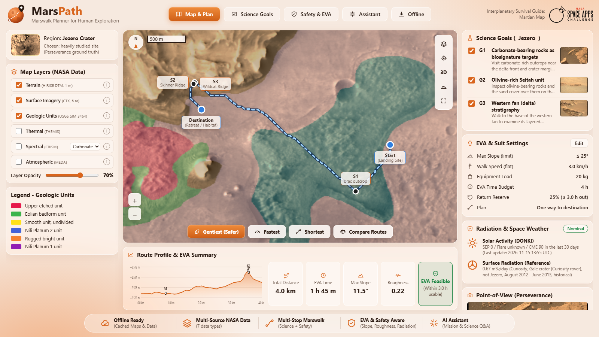
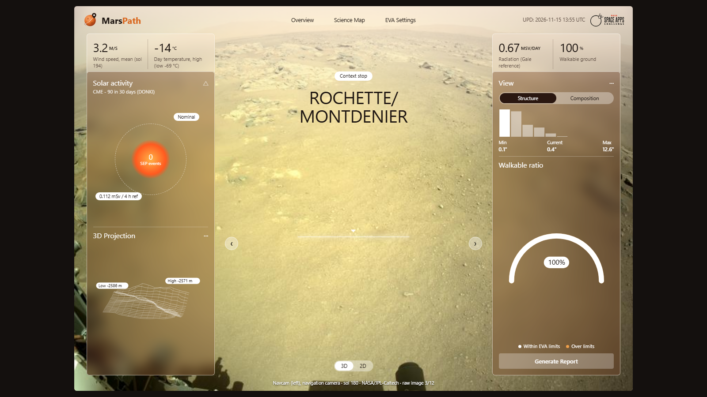

# MarsPath - terrain-aware Marswalk planner

NASA Space Apps 2026 - *Interplanetary Survival Guide: Martian Map*.
Backend: FastAPI + NumPy/SciPy/rasterio, A* routing. Frontend: plain HTML/JS with Leaflet (map) and Three.js (3D globe).




Submission text (summary, description, NASA data, use of AI): [SUBMISSION.md](SUBMISSION.md).

---

## 1. Quick start on Windows (about 5 minutes)

1. Unzip anywhere, for example `C:\marspath`. Open the folder in VS Code.
2. Double-click **`setup.bat`**. It creates `.venv`, installs packages, builds a **synthetic test region** and runs the tests.
3. Double-click **`run.bat`**. The browser opens at http://localhost:8000/app/

You will see a red **TEST FIXTURE** badge: that region is invented terrain, there only so the app works before the NASA data is downloaded.

Try this:
- Click **Set start**, then click the map.
- Click **Set destination**, then click the map.
- Optionally click a pin and choose **Add as stop**.
- Press **Calculate route** or **Compare profiles**.

The 3D globe (http://localhost:8000/app/) now opens the mission dashboard when you pick a region or press **Skip to map**. The earlier map page is still at http://localhost:8000/app/?classic=1.

Other pages:
- **Mission dashboard:** http://localhost:8000/app/dashboard.html (map, layers, multi-stop route, science goals, EVA settings, space weather, rover photos, assistant)
- **Helmet HUD:** http://localhost:8000/app/hud.html (visor view along the last planned route over real rover photos; move with the slider, play button or arrow keys; simulated position)
- **Rover + Walk-back:** button on the dashboard's route bar, or `POST /api/v1/routes/rover` (drive between stops, Apollo walk-back check at every point; NASA SEV concept numbers)
- **Point of view:** http://localhost:8000/app/pov.html (real Perseverance image at a stop with terrain, walkability and solar activity cards); opens from the dashboard's photo panel or a map click

API docs (all endpoints, try-it-out): http://localhost:8000/docs

Prefer the terminal? In VS Code: `python -m venv .venv`, then `.venv\Scripts\activate`, then `pip install -r requirements.txt`, then `python -m uvicorn app.main:app --app-dir backend --port 8000`.

## 2. Load real Jezero data

```
get_jezero_data.bat
```
This runs two scripts: `backend/scripts/fetch_data.py --all`, then `prepare_data.py jezero`.

The downloads go to `data/raw/jezero/`:

| File | Size | Used for |
|---|---|---|
| `M20_JezeroCrater_CTXDEM_20m.tif` (CTX DEM) | small | Elevation fallback |
| `JEZ_ctx_B_soc_008_orthoMosaic_6m_...tif` (CTX image) | medium | Base imagery |
| `JEZ_hirise_soc_006_DTM_..._1m_...tif` (HiRISE DTM) | **about 1.8 GB** | Main routing surface, 1 m |
| `M20_waypoints.json`, `M20_traverse.json` | small | Perseverance stops and track |
| SIM 3464 database zip (with `--all`) | about 350 MB | Geologic units + THEMIS day/night IR |

- **No time for the 1.8 GB file?** Run `fetch_data.py --small`. Everything still works on the 20 m CTX DEM; only roughness is coarser.
- **A download fails?** The script prints the dataset page. Download that file by hand into `data/raw/jezero/` (unzip zips there). File names do not matter much: files are found by pattern.
- **Want a different study box?** Edit `bbox` in `config/regions/jezero.json` (it must stay inside the HiRISE DTM: 77.22-77.58 E, 18.31-18.67 N), then run `prepare_data.py jezero` again.

When it has run, restart `run.bat`. "Jezero" is now in the region menu and selected by default.

## 3. Offline demo (Wi-Fi off)

1. While **online**, run **`build_offline.bat`**. It downloads the assistant documents, caches the Mars Trek context tiles and the DONKI space-weather window, and writes `data/cache/marspath_offline_jezero.zip`.
2. Rehearse with **`run_offline.bat`**: the backend refuses all network calls, like Wi-Fi off.
3. In the demo, physically switch Wi-Fi off and recalculate a route. The badge shows "Offline - using packaged data from <date>".

Everything the app needs is local: terrain, layers, pins, hazards, routing, space-weather cache and document search. Only the optional LLM answer needs the internet. Offline, the assistant answers in *extractive* mode: it quotes the best passage with its citation.

## 4. Science sites and the assistant (Person 5)

- **Science goals:** edit `science_goals` in `config/regions/jezero.json`. The three are drafts with sources; check the wording.
- **Curated science pins:** `config/science_sites/jezero.geojson` holds 10 verified Perseverance sample sites (Brac, Issole, Skinner Ridge, Wildcat Ridge, Amalik, Berea, the margin unit, the Three Forks depot, Rochette and the landing site), each tied to a science goal with a source link. It is generated by `backend/scripts/build_science_sites.py`: positions are the rover's own localizations (MMGIS waypoints) on the sampling sol, never typed by hand. Re-run `prepare_data.py jezero` after changing it.
- **Rover benchmark (proof):** `backend/scripts/validate_against_rover.py jezero` plans routes between Perseverance waypoints where the rover drove fairly directly and measures how close they stay to its real track, against a straight-line baseline. Result on the HiRISE DTM: median 61 m from the rover track vs 122 m for a straight line, closer in 4 of 5 stretches. Served at `/api/v1/validation`.
- **AI science assistant (RAG):** `data/docs/docs_sources.json` lists 21 public NASA/USGS documents and open-access papers. `fetch_docs.py` downloads them, adds MarsPath's own knowledge (science sites, datasets, EVA model, rover benchmark) and builds a hybrid index: BM25 keywords + a local embedding model (BAAI/bge-small-en-v1.5, about 65 MB, offline after the first download), merged by reciprocal-rank fusion. PDF citations keep page numbers. Questions asked at a map point also cite that point's terrain and geology (model-derived). Off-topic questions return "not found". `eval_assistant.py` scores retrieval on 15 questions: hybrid hit@1 14/15, hit@3 15/15. Each document's licence is recorded in `docs_sources.json` (all checked 2026-11-15). The documents are downloaded on each machine and are not stored in this repository.
- **LLM answers (optional):** set `GEMINI_API_KEY` (preferred) or `ANTHROPIC_API_KEY` in `local_keys.bat`. Every generated sentence is checked against the cited passages before it is shown. Without a key, answers are extractive, still cited.

## 5. Keys (optional)

- `NASA_API_KEY`: free at https://api.nasa.gov. Used for DONKI space weather. `DEMO_KEY` works but is rate-limited.
- `GEMINI_API_KEY`: for written assistant answers (Google Gemini; preferred). `GEMINI_MODEL` is optional; when empty, MarsPath picks a current "flash" model your key can use.
- `ANTHROPIC_API_KEY`: alternative provider for written assistant answers.
- `MARSPATH_OFFLINE=1`: forces offline behaviour.

Put them in a file called `local_keys.bat` next to `run.bat` (it is git-ignored; never commit keys):

```
@echo off
set NASA_API_KEY=your_key_here
set GEMINI_API_KEY=your_key_here
REM set ANTHROPIC_API_KEY=your_key_here
```

`run.bat` loads it automatically. Error messages from NASA calls are cleaned so the key never appears in the API or UI.

## 6. How the backend works

```
raw NASA/USGS files --prepare_data.py--> data/processed/<region>/  (terrain.npz, layers/*.png, pins, hazards, manifest.json)
                                              |
browser  <-->  FastAPI (backend/app/main.py)  +-- routing.py  A* on a time-cost surface
                                              +-- eva.py      suit walking model (team assumptions)
                                              +-- spaceweather.py  DONKI + RAD reference
                                              +-- assistant.py     BM25 search (+ optional LLM)
                                              +-- offline.py       tile cache, package zip
```

- **Coordinates:** Mars 2000 sphere (R = 3,396,190 m), planetocentric latitude, east-positive longitude, GeoJSON `[lon, lat]`. Never WGS84 or Web Mercator.
- **Elevation:** the HiRISE DTM is primary; the CTX DEM fills its gaps, shifted by the measured median offset. Slope and roughness come only from these numerical DEMs, never from images or hillshade. NoData stays NaN.
- **Roughness:** detrended RMS height in a 5x5 window on the ~2 m DEM, taking the max for each 10 m routing cell. It picks up boulder fields and scarp edges.
- **Route cost = modelled walking time:**
  - Speed comes from Tobler's hiking function on the *signed* grade of each step (uphill and downhill differ), rescaled to the suited flat speed and reduced for carried load.
  - Time is multiplied by a roughness factor and a geologic-unit factor (sand/rim, `config/geo_penalties.json`).
  - Steps steeper than the max grade, and cells steeper or rougher than the limits, are excluded.
  - Search is A* with an admissible heuristic, 8 directions. It is compiled with numba: about 0.1-0.4 s on a Jezero-sized grid.
- **Profiles:**
  - fastest: least time
  - gentlest: time plus a strong grade penalty
  - shortest: least distance within the limits
- **EVA check:** time out + time back + reserve vs the EVA budget.
- **Warnings (each with rule, value, threshold, location, data basis):**
  - R1 steep grade
  - R2 rough ground
  - R3 flagged geologic unit
  - R4 low-resolution DEM stretch
  - R5 EVA budget
  - R6 point moved to walkable ground
  - R7 recent SEP activity (DONKI)
- **Hazard pins:** connected zones over the slope or roughness limit, labelled *model-derived*. They are never a statement that other ground is safe.
- **Radiation:** the DONKI SEP, flare and CME window is an advisory (near-Earth catalogue). The Curiosity RAD Gale 2012-13 average (0.67 mSv/day, Hassler et al. 2014) is a labelled *reference scale*, never a Jezero or live value.

All EVA numbers are **team assumptions** in `config/eva_defaults.json`. Change them there or in the UI.

## 7. API (all under `/api/v1`)

| Method | Path | Purpose |
|---|---|---|
| GET | `/status`, `/health` | online/offline, regions ready, engine |
| GET | `/regions` | region list, bbox, layers, data date, science goals |
| GET | `/layers?region_id=` | layer metadata with mission, instrument, units, resolution, processing, limitations |
| GET | `/regions/{id}/layers/{png}` | overlay image |
| GET | `/tiles/{layer}/{z}/{y}/{x}` | Mars Trek tile proxy with a disk cache (works offline once cached) |
| GET | `/terrain/sample?region_id=&lon=&lat=` | elevation, slope, roughness and unit at a point |
| GET | `/science-sites?region_id=` | curated sites + Perseverance waypoints + traverse |
| GET | `/hazards?region_id=` | rule-based hazard zones (optional custom limits) |
| GET | `/validation?region_id=` | planner vs Perseverance's real drives (rover benchmark) |
| GET | `/point-info?region_id=&lon=&lat=[&from_lon=&from_lat=]` | "What's here?": terrain, 50 m neighbourhood, geology, walkability with reasons, nearest science site / rover stop / hazard, optional walk there and back |
| GET | `/search?region_id=&q=` | IAU place names, science sites and sample names, geologic units, `sol 509`, `77.40, 18.45`; accent- and typo-tolerant |
| POST | `/reachability` | walking range from a habitat: GeoJSON bands at 25/50/75/100% of usable EVA time (out and back) + science stops in range |
| GET | `/ground-view?region_id=&lon=&lat=` or `&site_id=` | real Perseverance images (Mastcam-Z, Navcam, Hazcam, WATSON) from the nearest rover stop |
| GET | `/ground-view/image/{image_id}?size=small\|medium` | locally cached copy of a rover image (works offline) |
| POST | `/ground-view/prefetch?region_id=` | while online: cache image lists and copies for every science site |
| GET | `/eva/defaults` | EVA parameters and their descriptions |
| POST | `/routes/calculate` | one route (start, stops[], destination, profile, eva overrides); includes turn-by-turn `directions` |
| POST | `/routes/compare` | several profiles side by side |
| POST/GET | `/missions`, `/missions/{id}`, `/missions/{id}/export?format=geojson\|csv\|json` | save and export |
| GET | `/space-weather?eva_hours=` | DONKI advisory + RAD reference |
| GET/POST | `/offline/package?region_id=[&download=true]`, `/offline/prefetch` | package manifest, zip, cache |
| POST | `/assistant/ask`, `/assistant/reindex` | cited answers from the loaded documents |

Errors are JSON `{"detail": {"code", "message"}}`:
- 404 `unsupported_region`
- 422 `outside_region` or a validation error
- 409 `no_route` or `enclosed`

## 8. Folder map (who owns what)

```
backend/app/        API + engines            -> Backend B (routing.py, eva.py, main.py), Backend A (prepare.py, processing.py)
backend/scripts/    data, docs, packaging    -> Backend A / Person 5
backend/tests/      pytest                   -> everyone: python -m pytest backend/tests -q
config/             region, EVA, penalties, science sites -> Person 5 + Backend
frontend/           index.html, app.js, style.css, sw.js -> Frontend A/B (restyle freely; keep the API calls)
data/               raw/, processed/, cache/, docs/, missions/
```

## 9. Troubleshooting

- **`pip install` fails on rasterio:** use Python 3.11-3.13 (64-bit) and upgrade pip. Last resort: `conda install -c conda-forge rasterio` in a conda environment.
- **Black map background:** the Mars Trek tiles need internet, or a cache from `build_offline.bat`. The region overlays work regardless.
- **`prepare_data.py` says elevation covers <5%:** the bbox is outside the downloaded DEM.
- **"enclosed" route error:** the point sits in terrain ringed by slopes over the limit. Move it or raise *Max slope*.
- **First route takes ~3 s:** numba compiles once, and later routes are fast. The compiled code is cached for later runs.

## Limitations (say these out loud)

- This is a prototype planning aid, not a certified navigation or safety system. Route scores are relative.
- Terrain is resolved at the DEM scale: rocks smaller than about 1-2 m are not seen.
- The data is dated and nothing is live. There are no dust, lighting or radiation-dose predictions.
- Walking-speed and load numbers are team assumptions based on an Earth hiking model.
- Weather is MEDA's record for the sol of each stop, not a forecast. The radiation figure is a Gale crater reference (2012-13), not a Jezero value.

## Data and credits

All terrain, imagery, weather and rover data are NASA/USGS products: HiRISE DTM, CTX DEM and orthomosaic, MOLA (Mars Trek tiles), THEMIS, CRISM, Perseverance waypoints, raw images and MEDA, DONKI, Curiosity RAD (published reference), USGS SIM 3464 geology and the Viking colorized global mosaic. The full table, with what each one is used for, is in [SUBMISSION.md](SUBMISSION.md#nasa-data-used). Third-party frontend files and their licences are listed in [frontend/vendor/SOURCES.md](frontend/vendor/SOURCES.md). The header shows the NASA Space Apps Challenge 2026 logo, unchanged, from the Space Apps brand page; no NASA insignia is used.

## Use of AI

- **Code:** much of the code, tests and documentation was written and reviewed with Claude Code (Anthropic). Those commits are marked "Co-Authored-By: Claude". The MarsPath logo is hand-coded SVG written the same way.
- **Assistant:** the in-app assistant writes answers with Google Gemini (or optionally Anthropic Claude), only from retrieved, cited passages. Each sentence is checked against them before it is shown. Search uses a local embedding model (BAAI bge-small-en-v1.5).
- **No AI-generated data:** no data or imagery in MarsPath is AI-generated.

## License

MarsPath's own code and documentation are under the [MIT License](LICENSE). Third-party files keep their own licences: Leaflet (BSD-2-Clause) and Three.js (MIT), listed in [frontend/vendor/SOURCES.md](frontend/vendor/SOURCES.md). NASA/USGS data and the assistant's documents keep their original terms (see [Data and credits](#data-and-credits) and `data/docs/docs_sources.json`). The Space Apps logo follows the Space Apps brand guidelines and is not covered by the MIT License.
